# ✨ Lethabo Mohapi ✨

<!-- A smaller typing animation prevents cropping on narrow mobile screens. -->
<picture>
  <source media="(max-width: 600px)" srcset="https://readme-typing-svg.demolab.com?font=Fira+Code&amp;weight=600&amp;size=16&amp;pause=1200&amp;color=7AA2F7&amp;center=true&amp;vCenter=true&amp;width=340&amp;lines=Software+Development+Student;Full-Stack+Developer;Based+in+South+Africa+%F0%9F%87%BF%F0%9F%87%A6" />
  
</picture>

**Software Development Student | Full-Stack Developer | South Africa**

*Building practical software solutions while developing my skills in application development, web technologies, and databases.*

 

 

**[About](#about) &nbsp; · &nbsp; [Skills](#skills) &nbsp; · &nbsp; [Projects](#projects) &nbsp; · &nbsp; [Activity](#activity) &nbsp; · &nbsp; [Connect](#connect)**

## 👨‍💻 About Me

<table>
<tr>
<td>

I'm a second-year IT student studying **Software Development at Rosebank International** in South Africa. I work with **Java, C#, JavaScript, HTML, CSS, and SQL**, and I'm building a portfolio that demonstrates my technical development through practical projects.

</td>
</tr>
</table>

| | |
|---|---|
| 🎯 **Current focus** | Completing my diploma and strengthening my software engineering foundations. |
| 💡 **Interests** | Full-stack development, web applications, application architecture, and databases. |
| 🧭 **Approach** | Write understandable, maintainable code and keep improving through hands-on practice. |

  

## 🛠️ Technical Skills

### Programming and Web Development

## 🚀 Selected Projects

<table>
<tr>
<td width="100%">

### 💰 StockvelSyncAPI

</td>
</tr>
<tr>
<td width="100%">

### 💰 StokvelSync_V2

</td>
</tr>
<tr>
<td width="100%">

### 📸 SpazaSnap

</td>
</tr>
</table>

Explore my repositories for coursework and software development projects:

## 📊 GitHub Activity

 

  

  

### 🐍 Contributions in Motion

  <picture>
    <source media="(prefers-reduced-motion: reduce) and (prefers-color-scheme: dark)" srcset="https://raw.githubusercontent.com/LethaboMohapi/LethaboMohapi/output/github-snake-dark-static.svg" />
    <source media="(prefers-reduced-motion: reduce)" srcset="https://raw.githubusercontent.com/LethaboMohapi/LethaboMohapi/output/github-snake-static.svg" />
    <source media="(prefers-color-scheme: dark)" srcset="https://raw.githubusercontent.com/LethaboMohapi/LethaboMohapi/output/github-snake-dark.svg" />
    
  </picture>

My contribution calendar, with a playful twist. Updated daily.

> **Note:** These statistics are generated by third-party services and may occasionally be unavailable.

## 🌐 Connect With Me

---

Learning continuously. Building deliberately.

